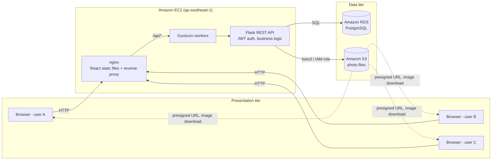
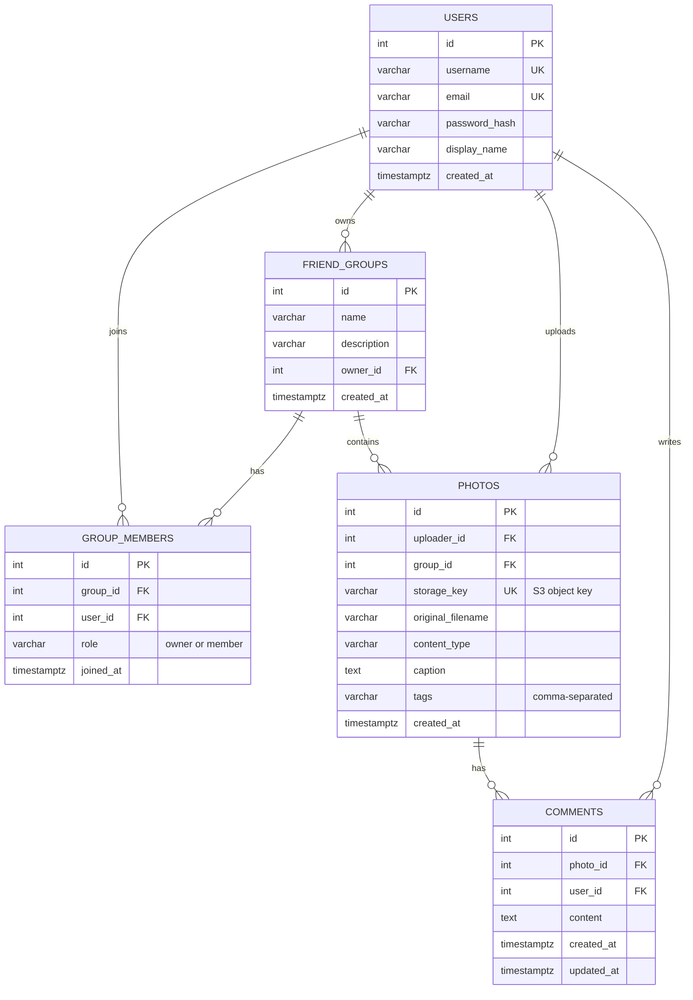

# System and Database Design (for report Sections 3 and 4)

## Tiers

| Tier | Technology | Runs on | Responsibility |
|---|---|---|---|
| Presentation (client) | React 18 + Vite, served by nginx | Browser / EC2 | Pages, forms, calls the REST API |
| Application (logic) | Python Flask REST API, Gunicorn (3 workers × 2 threads) | EC2 | Authentication, permission checks, validation, business rules |
| Data | PostgreSQL | Amazon RDS | Users, groups, memberships, photo metadata, comments |
| Storage | Object storage | Amazon S3 (private bucket) | Photo image files |

The tiers only talk through defined interfaces: the browser only calls `/api/*` over HTTP; only the Flask app talks to RDS (SQL) and S3 (AWS SDK, boto3). RDS is not reachable from the internet.

## Architecture diagram (Mermaid, paste into mermaid.live to export a PNG)

## Data flow

**Upload a photo**
1. The user picks a file in React; the browser sends `POST /api/photos` (multipart) with the JWT token.
2. nginx forwards the request to a Gunicorn worker running Flask.
3. Flask checks the token, checks the user is a member of the chosen group, and validates the file type and size.
4. Flask generates a random key (`photos/<group>/<uuid>.jpg`) and uploads the file to S3.
5. Flask inserts a row into `photos` in RDS (uploader, group, key, caption, tags, time). If the insert fails, the S3 file is deleted so storage and database stay consistent.
6. The API returns the photo as JSON with a presigned S3 URL.

**View the feed**
1. React calls `GET /api/photos` with optional search/filter parameters.
2. Flask builds one SQL query limited to the user's groups, adds the filters, and paginates.
3. For each photo Flask creates a presigned URL (valid 1 hour). The browser then downloads images **directly from S3**, so image traffic does not load the EC2 server.

**Comment**
1. React sends `POST /api/photos/<id>/comments`.
2. Flask checks group membership and inserts one row into `comments`.
3. Other users' photo pages refresh every 10 seconds and show the new comment.

## Handling concurrent users

| Challenge | How the design handles it |
|---|---|
| Many requests at once | Gunicorn runs several worker processes and threads; each has its own DB connection pool |
| Two users register the same username | `UNIQUE` constraint in PostgreSQL; the second insert fails and returns 409 |
| Many users comment on one photo | Each comment is a separate `INSERT`, so no row is overwritten (no lost updates) |
| Two users upload files with the same name | Random UUID storage keys, so files never collide in S3 |
| Adding a friend twice at the same time | `UNIQUE (group_id, user_id)` on `group_members` |
| Scaling to more servers | The API is stateless (JWT, no server sessions), and all data is in RDS/S3, so more EC2 instances can be added behind a load balancer |
| Unauthorised access | Every photo/comment request checks group membership; the S3 bucket is private and links expire |

## Database design (ERD)

## Data storage strategy

- **Structured data in a relational database (RDS PostgreSQL).** Users, groups, memberships, photo metadata and comments have clear relationships, so foreign keys, unique constraints and transactions keep them consistent under concurrent access.
- **Binary files in object storage (S3).** Images are large and are never queried by content, so they are stored in S3, and the database keeps only the object key. This keeps the database small and fast, and S3 scales storage automatically.
- **Timestamps** are stored as `TIMESTAMPTZ` (UTC) and converted to local time in the browser.
- **Passwords** are stored only as salted hashes (Werkzeug scrypt).
- **Deletes cascade**: deleting a photo removes its comments; deleting a group removes its memberships and photos.

## Search and filter (bonus, report Section 5)

Search is done in the database with one SQL query built from the filters the user sets:

- Keyword `q` uses case-insensitive `ILIKE` on caption, tags, uploader name, and an `EXISTS` sub-query on comment text.
- Uploader, tag, group and date range are added as `WHERE` conditions.
- Results are always limited to the user's own groups, sorted by date and paginated.
- Indexes on `photos(group_id)`, `photos(uploader_id)`, `photos(created_at)` and `comments(photo_id)` keep these queries fast.

Possible improvement to mention: PostgreSQL full-text search (`tsvector` with a GIN index) for larger data sets.
